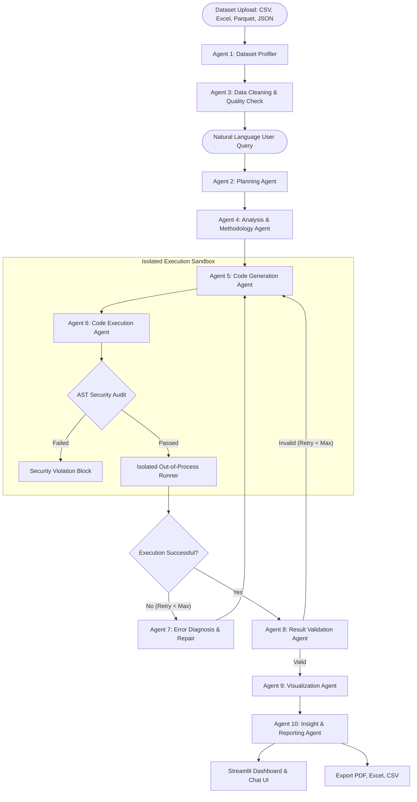

# 🧠 AUTONOMOUS DATA ANALYST AI

An enterprise-grade, fully autonomous analytical system powered by a multi-agent **LangGraph** orchestration workflow, isolated execution sandboxes, and **Streamlit**.

The system autonomously ingests datasets (CSV, Excel, Parquet, JSON), profiles data types and distributions, formulates analytical plans, generates and executes secure Python/Pandas code in an isolated environment, self-corrects runtime exceptions, validates mathematical correctness, renders interactive Plotly visualizations, and exports executive reports (PDF, Excel, CSV).

---

## 🏛️ System Architecture



---

## 🤖 The 10 Specialized Agents

| # | Agent Name | Core Responsibilities |
|---|------------|-----------------------|
| **1** | **Dataset Profiler Agent** | Scans datasets, infers types (numeric, categorical, datetime, text), calculates missingness, detects duplicates and IQR outliers, identifies primary key candidates, and generates a data health rating. |
| **2** | **Planning Agent** | Classifies analytical intent (descriptive, diagnostic, predictive, prescriptive), isolates relevant columns, decomposes questions into sequential subtasks, formulates assumptions, and suggests chart types. |
| **3** | **Data Cleaning Agent** | Detects data defects, proposes non-destructive and destructive transformations, requests explicit approval for destructive actions, and preserves original datasets. |
| **4** | **Analysis Agent** | Formulates exact mathematical formulas, statistical methods (correlations, ANOVA, linear trends, clustering), and defines output specifications for code generation. |
| **5** | **Code Generation Agent** | Writes clean, dataset-aware Python code using Pandas, NumPy, SciPy, and Plotly. Adheres strictly to the structured output container interface (`OUTPUT['tables']`, `OUTPUT['metrics']`, `OUTPUT['figures']`). |
| **6** | **Code Execution Agent** | The sole authorized component permitted to dispatch code to the isolated sandbox with strict resource limits, timeouts, and no network access. |
| **7** | **Error Diagnosis Agent** | Analyzes runtime exceptions (KeyError, TypeError, SyntaxError), diagnoses root causes, leverages fuzzy column matching, and produces targeted repairs without infinite loops. |
| **8** | **Result Validation Agent** | Validates mathematical soundness, checks for illegal NaNs/Infinities, verifies non-empty tables, checks boundary conditions, and confirms the question was genuinely answered. |
| **9** | **Visualization Agent** | Generates interactive Plotly visualizations (line charts for trends, bar charts for comparisons, histograms for distributions, scatter plots for relationships, box plots for outliers) and provides natural language chart explanations. |
| **10** | **Insight & Reporting Agent** | Synthesizes verified numbers into an executive summary, identifies key findings with empirical evidence, distinguishes correlation from causation, and provides actionable recommendations. |

---

## 🛠️ Technology Stack

- **Backend**: Python 3.11+, Pandas, NumPy, SciPy, Scikit-learn
- **Orchestration**: LangGraph, LangChain Core, Pydantic v2
- **LLM Engine**: OpenAI API (`gpt-4o`, `gpt-4o-mini`, `o3-mini`) with deterministic fallback heuristics
- **Execution Sandbox**: Hardened out-of-process subprocess runner with AST static security filtering, environment sanitization, timeouts, and memory limits
- **Database & Persistence**: SQLAlchemy, SQLite
- **Frontend**: Streamlit, Plotly Interactive Charts, Pandas Styler
- **Reporting**: ReportLab (PDF), OpenPyXL (Excel), CSV export
- **Configuration**: Pydantic Settings, `python-dotenv`

---

## 📁 Project Directory Structure

```text
autonomous-data-analyst/
├── app.py                      # Streamlit application UI & interactive dashboard
├── requirements.txt            # Python dependencies
├── .env.example                # Sample environment configuration
├── config/
│   ├── __init__.py
│   └── settings.py             # Pydantic Settings & environment variables
├── agents/                     # 10 Specialized Agents
│   ├── __init__.py
│   ├── profiler_agent.py
│   ├── planner_agent.py
│   ├── cleaning_agent.py
│   ├── analyst_agent.py
│   ├── code_agent.py
│   ├── execution_agent.py
│   ├── error_agent.py
│   ├── validation_agent.py
│   ├── visualization_agent.py
│   └── reporting_agent.py
├── graph/                      # LangGraph Multi-Agent Orchestration
│   ├── __init__.py
│   ├── state.py                # Shared workflow state dictionary
│   ├── routing.py              # Conditional edge routers
│   └── workflow.py             # Graph construction & state machine
├── sandbox/                    # Secure Code Execution
│   ├── __init__.py             # Sandbox factory
│   ├── security.py             # AST static code security auditor
│   └── secure_subprocess_executor.py # Isolated out-of-process runner
├── analytics/                  # Reusable Analytical Engines
│   ├── __init__.py
│   ├── profiling.py            # File loading & type/statistical profiling
│   ├── cleaning.py             # Quality assessment & cleaning transforms
│   ├── descriptive.py          # Summary statistics & correlations
│   ├── diagnostic.py           # Segment comparisons & ANOVA
│   ├── predictive.py           # Trend forecasting & K-Means clustering
│   └── anomaly.py              # IQR & Isolation Forest anomaly detection
├── visualization/              # Visualization Modules
│   ├── __init__.py
│   ├── charts.py               # Plotly figure builder
│   └── chart_selector.py       # Heuristic chart selector
├── reporting/                  # Multi-Format Report Exporters
│   ├── __init__.py
│   ├── pdf_report.py           # Executive PDF generator (ReportLab)
│   └── excel_report.py         # Multi-sheet Excel generator (OpenPyXL)
├── database/                   # Database & Storage
│   ├── __init__.py
│   ├── models.py               # SQLAlchemy ORM models
│   └── repository.py           # Session & trace repository
├── services/                   # Application Services
│   ├── __init__.py
│   ├── dataset_service.py      # Dataset loading, caching, sample generator
│   ├── session_service.py      # Conversational session management
│   └── llm_service.py          # OpenAI client wrapper with fallback
├── schemas/                    # Pydantic Data Contracts
│   ├── __init__.py
│   ├── dataset.py              # DatasetProfile & ColumnProfile
│   ├── analysis.py             # AnalysisPlan & CleaningReport
│   ├── execution.py            # ExecutionResult, ErrorDiagnosis, ValidationResult
│   └── report.py               # AnalyticalReport, ChartArtifact, InsightItem
├── tests/                      # Comprehensive Test Suite (29 tests)
│   ├── __init__.py
│   ├── test_profiler.py        # Profiling and file loading tests
│   ├── test_security.py        # AST security and sandboxing tests
│   ├── test_executor.py        # Isolated code execution & timeout tests
│   ├── test_agents.py          # Unit tests for individual agents
│   ├── test_workflow.py        # Integration tests for LangGraph pipeline
│   └── test_benchmark_suite.py # 10 Ground-truth analytical benchmark tests
├── data/
│   ├── uploads/                # Directory for user-uploaded files
│   └── samples/                # Bundled sample datasets (Superstore)
└── reports/                    # Exported PDF and Excel reports
```

---

## 🚀 Quickstart & Installation

### 1. Prerequisites
- Python 3.11, 3.12, or 3.13 / Anaconda

### 2. Setup Environment & Install Dependencies
```bash
# Optional: create virtual environment
python -m venv venv
venv\Scripts\activate

# Install dependencies
pip install -r requirements.txt
```

### 3. Configure Environment Variables
Copy `.env.example` to `.env`:
```bash
cp .env.example .env
```
Edit `.env` to configure your API keys (optional, fallback heuristics work without a key):
```ini
OPENAI_API_KEY=your_openai_api_key_here
OPENAI_MODEL=gpt-4o-mini
EXECUTION_SANDBOX_TYPE=secure_subprocess
SANDBOX_TIMEOUT_SECONDS=30
SANDBOX_MAX_MEMORY_MB=512
MAX_CORRECTION_RETRIES=3
DATABASE_URL=sqlite:///./data/autonomous_analyst.db
LOG_LEVEL=INFO
```

### 4. Run the Streamlit Application
```bash
streamlit run app.py
```
Open your browser at **[http://localhost:8501](http://localhost:8501)**.

---

## 🧪 Running the Test & Benchmark Suite

The project includes 29 unit, integration, and benchmark tests covering:
- Dataset profiling across CSV, Excel, and edge cases.
- Static code AST security (blocking `os`, `sys`, `socket`, `open`, `__subclasses__`).
- Sandbox timeout enforcement and runtime exception handling.
- Multi-agent LangGraph workflow and conversational follow-ups.
- PDF and Excel report exports.
- **10 Ground-Truth Analytical Benchmarks** measuring numerical accuracy against known expected values.

Run all tests:
```bash
pytest -v
```

Run only the 10 ground-truth analytical benchmarks:
```bash
pytest tests/test_benchmark_suite.py -v
```

---

## 🛡️ Security Architecture

1. **AST Pre-Execution Audit**: Every generated script is parsed into an Abstract Syntax Tree (`ast.parse`) before execution. The `CodeSecurityAuditor` validates that:
   - Only approved analytical packages (`pandas`, `numpy`, `scipy`, `sklearn`, `plotly`, `math`, `datetime`, `collections`, `re`, `json`) are imported.
   - Forbidden modules (`os`, `sys`, `subprocess`, `socket`, `requests`, `urllib`, `builtins`) are strictly blocked.
   - Arbitrary file access and execution builtins (`open`, `eval`, `exec`, `__import__`, `globals`, `locals`) are rejected.
   - Sandbox escape vectors (e.g., `().__class__.__bases__[0].__subclasses__()`) are blocked.
2. **Out-of-Process Execution**: Generated code is **never** executed inside the Streamlit server process. It runs inside an isolated subprocess in a temporary directory.
3. **Environment Sanitization**: Host environment variables and secrets (including `OPENAI_API_KEY`) are stripped before subprocess execution.
4. **Resource Constraints**: Strict wall-clock execution timeouts (default 30s) and memory caps (default 512MB) are enforced via `psutil`.

---

## 💬 Example Analytical Session

### Step 1: Upload or Load Dataset
Click **Load Sample Superstore Dataset** in the sidebar. The system profiles 1,508 transactions and computes a Health Score of `100.0/100`.

### Step 2: Ask an Initial Question
> **User**: *"Which region performs best by total sales?"*
- **Planning Agent**: Identifies `diagnostic` intent; isolates columns `['Region', 'Sales']`.
- **Code Agent**: Generates Pandas groupby aggregation and Plotly bar visualization.
- **Execution Agent**: Runs code in sandbox in 0.42s; extracts metrics: `top_segment: 'South'`, `top_segment_sales: 326,981.42`.
- **Validation Agent**: Confirms non-empty results and valid positive totals.
- **Reporting Agent**: Summarizes that the South region generated the highest sales ($326,981.42), accounting for ~35% of total revenue.

### Step 3: Conversational Follow-Up
> **User**: *"Show its monthly trend."*
- **Planning Agent**: Recognizes follow-up context; narrows scope to `South` region and `Order_Date`.
- **Execution**: Resamples monthly sales for South and plots an interactive Plotly line chart with Month-over-Month growth indicators.

### Step 4: Export Report
Navigate to the **Export Reports** tab:
- Download the executive **PDF Report** with formatted tables, metrics, and recommendations.
- Download the multi-sheet **Excel Workbook** with raw data and executive summaries.
